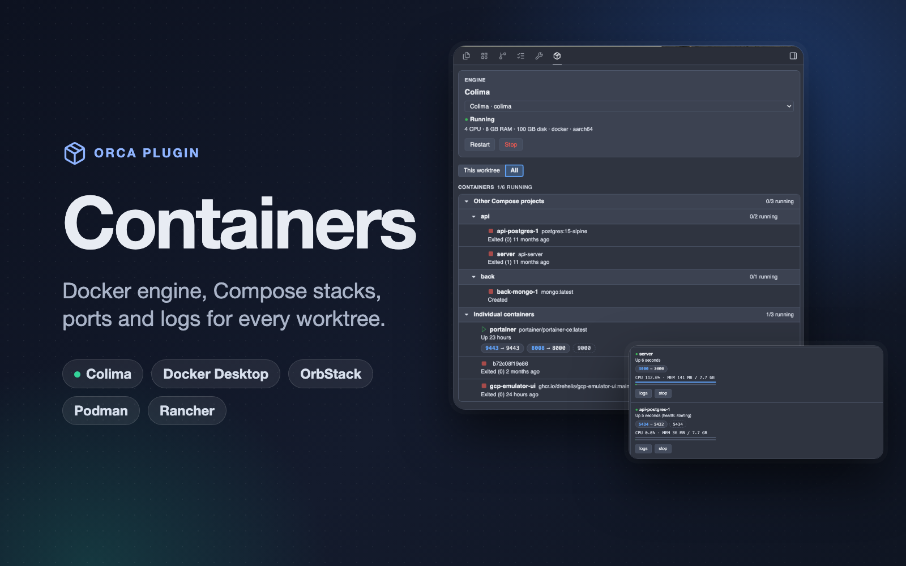

# Containers for Orca

Manage your Docker engine and the containers of the worktree you are working in, from a panel in
[Orca](https://www.onorca.dev)'s right sidebar. It works with any Docker-compatible engine:
[Colima](https://github.com/abiosoft/colima), Docker Desktop, OrbStack, Podman, Rancher Desktop
or any other Docker context.

## Features

| Area | What you get |
| --- | --- |
| **Engine** | Pick the engine from a selector (every Docker context; your choice is remembered, the default is the Docker CLI's current context). The card shows which engine it is and its status. Colima: CPU, memory, disk, runtime, arch; start with a chosen number of CPUs and GB of memory (remembered), stop and restart with a confirmation click. Docker Desktop (`docker desktop` plugin, else `open -a Docker` to start), OrbStack (`orb`), Podman (`podman machine`) and Rancher Desktop (`rdctl`): start, stop and restart where their CLI allows it. Any other context: status only. |
| **Compose** | The Compose stacks of the active worktree, found from container labels and from compose files in the worktree root. Up, Restart and Down (never removes volumes; Down asks for confirmation). Long operations run in the background. |
| **Containers** | Two views, remembered between sessions. *This worktree* follows the focused workspace: containers whose Compose working directory is inside it, with status, CPU and memory usage, start/stop and a shell in a new Orca terminal. *All* is an overview tree (Orca project, worktree, containers, then other Compose projects and individual containers) with status and ports; click a worktree, a Compose project or one of its containers to open its detail view, and use **← All** to go back. Right-click a worktree, Compose project or container (or use the **⋯** button, Shift+F10 or the context-menu key) for a menu with details, logs, start, stop, restart, down, up and shell. |
| **Ports** | Published ports as chips (`host port → container port`); internal-only ports are shown dashed. Click a chip to copy `host:port`. |
| **Logs** | *Live* mode follows the container's output with timestamps. *History* mode pages back through older lines and searches the whole log (plain text, optional case sensitivity), with a jump to the context around any match. |

The panel follows workspace switches: when you move to another worktree it shows that
worktree's stacks and containers.

## Requirements

- macOS with the Docker CLI and the Compose plugin, plus a Docker-compatible engine
  (for example `brew install colima docker docker-compose`).
- Orca 1.4.246 or later.

`docker`, `orca` and the engine CLIs (`colima`, `orb`, `podman`, `rdctl`) are looked up on `PATH`,
then in `/opt/homebrew/bin` and `/usr/local/bin`. Every Docker command runs with
`--context <engine>`; an inherited `DOCKER_HOST` is ignored. Only the Colima adapter has been
tested against a real CLI; the other engine controls follow each vendor's documentation.

## Install

In Orca, open Settings → Plugins and search for **Containers**, or install it from Git with
`https://github.com/rgarciade/orca-containers.git#v0.1.1`. Approve the plugin, then open the
**Containers** panel (package icon) in the right sidebar.

For development, add a clone of this repository under Settings → Plugins →
**Development folders…**.

## How the active worktree is found

Orca tells plugins the focused workspace's branch, name and terminals, but not its path. The
plugin maps an open terminal to its worktree, which always works. Without a terminal it matches
the branch and name against Orca's worktree list; when several worktrees share them (for
example, many repositories on `dev` with the automatic name `dev`), the panel asks you to open a
terminal. Giving the worktree a unique name in Orca also resolves it.

## Permissions

| Capability | Why |
| --- | --- |
| `workspace:read` | Know which worktree is focused. |
| `storage:own` | Remember the chosen engine, and the CPU and memory chosen for the Colima VM. |
| `notifications:show` | Confirm the **Containers: refresh** palette command. |

The worker runs `docker`, the engine CLIs and the `orca` CLI as child processes without a shell, except
for the terminal commands (shell and log watchdog), which only receive validated container ids
and quoted paths. Actions are limited to containers of the active worktree. Log processes are
stopped when you close the log view, about 15 seconds after the panel closes, and when the
worker exits, even if it is killed abruptly.

## Files

- `orca-plugin.json`: manifest.
- `worker.mjs`: runs engine, Docker and Orca CLI commands and answers the panel.
- `panel/index.html`: the sidebar panel.

## Licence

MIT. See [LICENSE](LICENSE).
