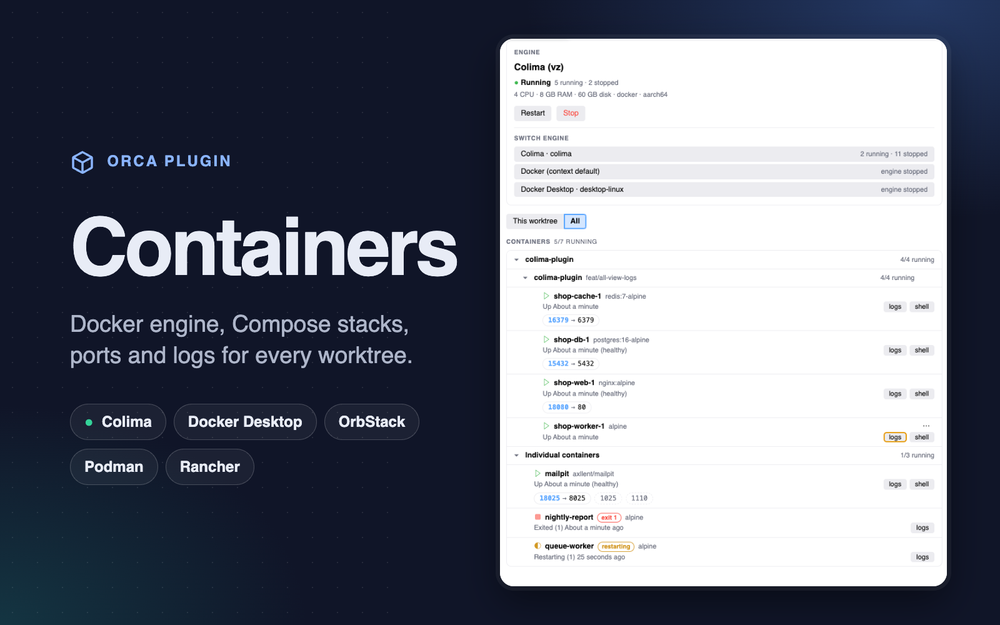

# Containers for Orca

Manage your Docker engine and the containers of the worktree you are working in, from a panel in
[Orca](https://www.onorca.dev)'s right sidebar. It works with any Docker-compatible engine:
[Colima](https://github.com/abiosoft/colima), Docker Desktop, OrbStack, Podman, Rancher Desktop
or any other Docker context.



## Features

| Area | What you get |
| --- | --- |
| **Engine** | Your choice of engine is remembered (the default is the Docker CLI's current context). The card shows which engine it is, its status and its running and stopped containers. Colima: CPU, memory, disk, runtime, arch; start with a chosen number of CPUs and GB of memory (remembered), stop and restart with a confirmation click. Docker Desktop (`docker desktop` plugin, else `open -a Docker` to start), OrbStack (`orb`), Podman (`podman machine`) and Rancher Desktop (`rdctl`): start, stop and restart where their CLI allows it. Any other context: status only. With more than one engine, **Switch engine** lists the others; click a row to switch to it. Local engines show their containers as `N running · M stopped`, or `engine stopped` (no socket) or `unavailable` (no answer), refreshed about every 30 seconds. The selected engine shows its counts once its containers have been listed, so not while the active worktree cannot be resolved. The `default` context is hidden when it is the same daemon as another one. Remote contexts (`ssh://`, `tcp://`) show `remote` and are not contacted until you pick one. If the selected engine fails or hangs, the card stays, says what could not be read and keeps **Switch engine** usable, also while a switch is in progress. |
| **Compose** | The Compose stacks of the active worktree, found from container labels and from compose files in the worktree root. Paths from labels must stay inside the worktree, also after following symlinks. Up, Restart and Down (never removes volumes; Down asks for confirmation). Long operations run in the background. |
| **Containers** | Two views, remembered between sessions. *This worktree* follows the focused workspace: containers whose Compose working directory is inside it, with status, CPU and memory usage, and start/stop. *All* is an overview tree (Orca project, worktree, containers, then other Compose projects and individual containers) with status and ports; click a worktree, a Compose project or one of its containers to open its detail view, and use **← All** to go back. Each container row has a **logs** button and, while it is running, a **shell** button, which act without leaving the overview (not for Compose projects with no known working directory). Right-click a worktree, Compose project or container (or use the **⋯** button, Shift+F10 or the context-menu key) for a menu with details, logs, start, stop, restart, down, up and shell. Containers that are unhealthy, restarting, starting their healthcheck or stopped with an abnormal exit code (other than 0, 130 and 143) are labelled. A collapsed group counts its unhealthy, restarting and abnormally exited containers (exit 137 and `health: starting` are not counted). |
| **Shell** | Open a shell (bash when the image has it, else sh) in any running container, as a new terminal tab in Orca: in the container's worktree, or in the focused workspace for containers outside Orca worktrees. |
| **Ports** | Published ports as chips (`host port → container port`); internal-only ports are shown dashed. Click a chip to copy `host:port`. |
| **Logs** | The **logs** button of a container opens a log viewer inside its card (below its row in the *All* tree, without leaving it) and scrolls to it; press it again, or **close**, to close it. Up to 3 viewers can be open, each on its own; a fourth closes the oldest and says so. They all close when you change workspace, view, scope or engine, and one closes when its container leaves the list or you collapse the group that holds it. *Live* mode follows the container's output with timestamps. *History* mode pages back through older lines and searches the whole log (plain text, optional case sensitivity), with a jump to the context around any match. **Expand** fills the panel with that viewer (**Collapse** or Escape goes back). Drag the bar under the log, or focus it and use the arrow keys, to change its height (one height for all viewers, remembered; Enter or double-click resets it). **Open in terminal** opens a new Orca terminal tab with the last 200 lines, following unless the container is stopped, in the same worktree as **Shell** would use. That terminal is yours: the plugin never closes it. |

The panel follows workspace switches: when you move to another worktree it shows that
worktree's stacks and containers.

## Requirements

- macOS with the Docker CLI and the Compose plugin, plus a Docker-compatible engine
  (for example `brew install colima docker docker-compose`).
- Orca 1.4.246 or later.

`docker`, `orca` and the engine CLIs (`colima`, `orb`, `podman`, `rdctl`) are looked up on `PATH`,
then in `/opt/homebrew/bin` and `/usr/local/bin` (on Linux the Orca CLI is `orca-ide`). Every Docker command runs with
`--context <engine>`; an inherited `DOCKER_HOST` is ignored. Only the Colima adapter has been
tested against a real CLI; the other engine controls follow each vendor's documentation.

## Install

In Orca, open Settings → Plugins and search for **Containers**, or install it from Git with
`https://github.com/rgarciade/orca-containers.git#v0.1.1`. Approve the plugin, then open the
**Containers** panel (package icon) in the right sidebar.

For development, add a clone of this repository under Settings → Plugins →
**Development folders…**.

## How the active worktree is found

Orca tells plugins the focused workspace's branch, name and terminals, but not its path. The
plugin maps an open terminal to its worktree, which always works. Without a terminal it matches
the branch and name against Orca's worktree list; when several worktrees share them (for
example, many repositories on `dev` with the automatic name `dev`), the panel asks you to open a
terminal. Giving the worktree a unique name in Orca also resolves it.

## Permissions

| Capability | Why |
| --- | --- |
| `workspace:read` | Know which worktree is focused. |
| `storage:own` | Remember the chosen engine, container view and log height, and the CPU and memory chosen for the Colima VM. |
| `notifications:show` | Confirm the **Containers: refresh** palette command. |

For the **Switch engine** list the worker also runs `docker --context <name> ps -a --format '{{.State}}'` on the other local
engines (`unix://` sockets and local named pipes); listing them never contacts remote contexts.

The worker runs `docker`, the engine CLIs and the `orca` CLI as child processes without a shell, except
for the shell and log terminals and the log watchdog, which only receive validated container ids
and quoted paths. Container actions are limited to the containers
of the scope the panel is acting on (the active worktree, or a worktree, Compose project or container
chosen in the *All* view), and the worker checks that membership on every request. Log processes are
stopped when you close their log viewer, about 15 seconds after the panel closes, and when the
worker exits, even if it is killed abruptly.

## Files

- `orca-plugin.json`: manifest.
- `worker.mjs`: worker entry; `activate` and the panel handler registration.
- `lib/`: the worker's modules, which run the engine, Docker and Orca CLI commands.
  - `exec.mjs` (binary lookup, child environment), `docker.mjs` (selected engine and `--context`), `containers.mjs` (`docker ps`).
  - `engines/`: `context.mjs` (context parsing and engine detection), `control.mjs` (engine CLI commands), `vm.mjs` (status, start, stop, restart), `others.mjs` (the Switch engine list).
  - `worktree.mjs`, `scope.mjs`: the focused worktree, scope validation and container ownership.
  - `compose-stacks.mjs`, `compose.mjs`: stack discovery and Compose actions.
  - `overview.mjs`, `stats.mjs`: the All tree, CPU and memory.
  - `terminal.mjs`, `shell.mjs`: the shell and log terminal tabs and their command lines.
  - `prefs.mjs`: the remembered log height.
  - `logs/`: `process.mjs` (log processes and watchdog), `follow.mjs`, `history.mjs`, `search.mjs`, `tokens.mjs`, `text.mjs`.
- `panel/index.html`: the sidebar panel.
- `test/`: unit tests for the worker's logic.

## Tests

With Node 22, from the repository root (no dependencies, and no Docker, Orca or Colima needed):

```sh
node --test
```

## Licence

MIT. See [LICENSE](LICENSE).
